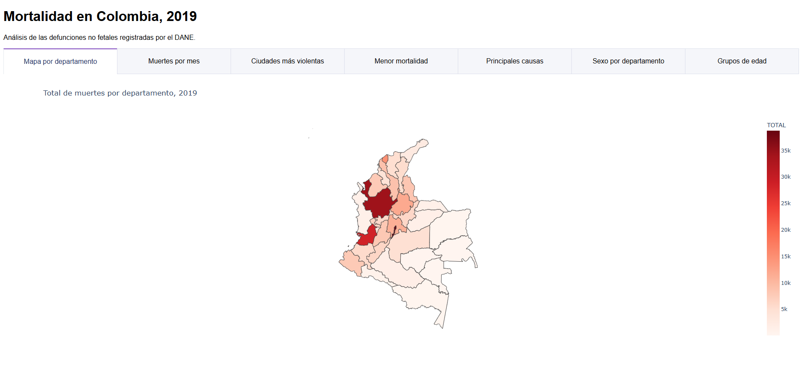
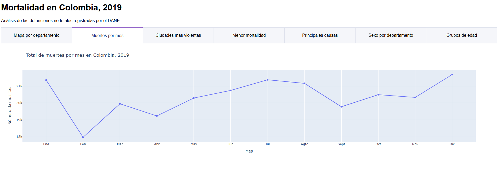
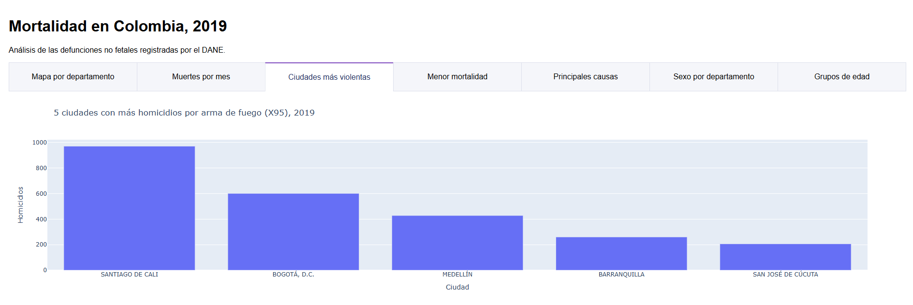
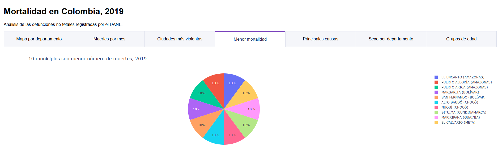
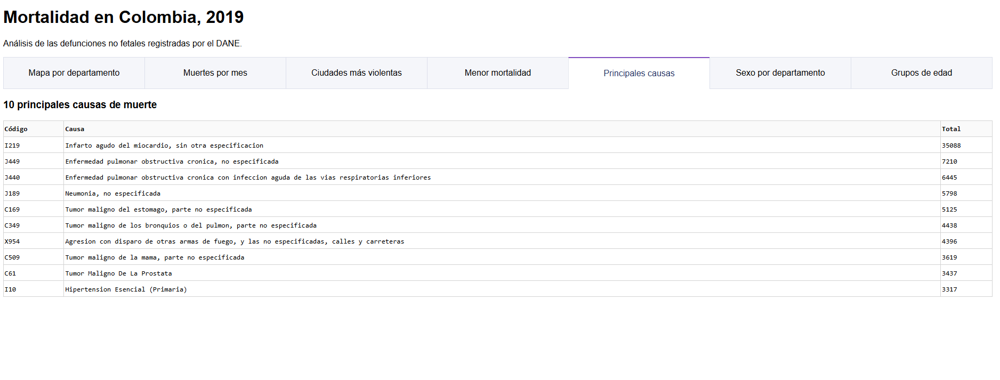
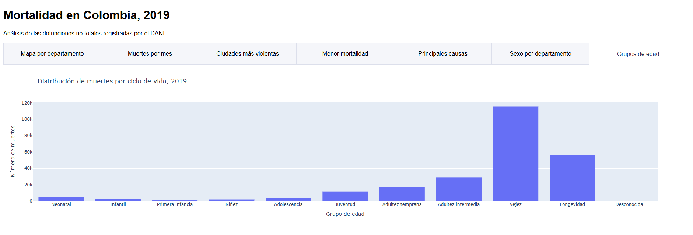

# Mortalidad en Colombia, 2019

Aplicación web interactiva construida con **Python, Dash y Plotly** para explorar las defunciones no fetales registradas en Colombia durante 2019, a partir de las Estadísticas Vitales (EEVV) del DANE.

**Aplicación en línea:** https://mortalidad-colombia-2019-rkiw.onrender.com
**Repositorio:** https://github.com/Corb404/proyecto-de-pagina

> La aplicación usa el plan gratuito de Render. Si lleva un rato sin visitas, la primera carga puede tardar entre 30 y 60 segundos mientras el servidor se activa.

---

## 1. Introducción

Este proyecto convierte los microdatos de mortalidad del DANE para 2019 en un tablero visual e interactivo. La aplicación integra siete visualizaciones organizadas en pestañas que permiten identificar patrones geográficos, temporales, demográficos y de causas de muerte en el país.

## 2. Objetivo

Analizar la mortalidad en Colombia durante 2019 para responder preguntas como:

- ¿Cómo se distribuyen las muertes entre los departamentos?
- ¿Cómo varían las muertes a lo largo del año?
- ¿Qué ciudades concentran más homicidios por arma de fuego?
- ¿Cuáles son las principales causas de muerte?
- ¿Existen diferencias entre hombres y mujeres por departamento?
- ¿En qué etapas del ciclo de vida se concentra la mortalidad?

## 3. Estructura del proyecto

```
proyecto-de-pagina/
├── app.py                 # Aplicación Dash: layout con pestañas y servidor
├── procesamiento.py       # Carga, limpieza y unión de los datos
├── graficos.py            # Una función por cada visualización
├── data/
│   ├── NoFetal2019.csv                  # Microdatos de mortalidad (convertidos desde Excel)
│   ├── CodigosDeMuerte.xlsx             # Catálogo de causas CIE-10
│   ├── Divipola.xlsx                    # División político-administrativa
│   └── colombia_departamentos.geojson   # Contornos de los departamentos para el mapa
├── img/                   # Capturas de pantalla usadas en este README
├── requirements.txt       # Librerías y versiones necesarias
├── .gitignore             # Archivos excluidos del repositorio (venv, __pycache__)
└── README.md
```

**Flujo de la aplicación:** `procesamiento.py` carga y une los datos → `graficos.py` genera cada figura → `app.py` las organiza en pestañas y levanta el servidor.

### Procesamiento de los datos

1. **Mortalidad:** el archivo original `NoFetal2019.xlsx` se convirtió a CSV para acelerar la lectura. Contiene **244 355 registros**, uno por persona fallecida.
2. **Divipola:** se unió a mortalidad mediante la columna `COD_DANE` para obtener el nombre del departamento y del municipio. Todos los registros encontraron correspondencia.
3. **Códigos de muerte:** el archivo trae 8 filas de título antes de los encabezados, por lo que se leyó con `header=8`. Se unió mediante `COD_MUERTE` para obtener el nombre de la causa.
4. **Códigos de 3 caracteres:** 22 735 registros (9,3 %) tenían códigos CIE-10 sin subdivisión (por ejemplo, `C61` o `I10`), mientras que el catálogo los registra con una `X` final (`C61X`). Estos casos se completaron con la descripción a 3 caracteres del catálogo. Sin esta corrección, causas como el cáncer de próstata y la hipertensión habrían desaparecido del análisis.

## 4. Requisitos

| Librería | Versión |
| --- | --- |
| Python | 3.14 |
| dash | 4.4.1 |
| plotly | 7.1.0 |
| pandas | 3.1.0 |
| numpy | 2.5.4 |
| openpyxl | 3.1.5 |
| gunicorn | 26.2.0 |

La lista completa, con todas las dependencias, está en `requirements.txt`.

## 5. Software utilizado

- **Python:** lenguaje de programación.
- **pandas:** lectura, limpieza, unión y agregación de datos.
- **Plotly Express:** construcción de las visualizaciones interactivas.
- **Dash:** framework para la aplicación web.
- **Gunicorn:** servidor web de producción.
- **Visual Studio Code:** editor de código.
- **Git y GitHub:** control de versiones y alojamiento del repositorio.
- **Render:** plataforma como servicio (PaaS) para el despliegue.

## 6. Instalación local

1. Clonar el repositorio:
   ```bash
   git clone https://github.com/Corb404/proyecto-de-pagina.git
   cd proyecto-de-pagina
   ```
2. Crear y activar un entorno virtual:
   ```bash
   python -m venv venv
   # Windows (PowerShell)
   .\venv\Scripts\Activate.ps1
   # Mac / Linux
   source venv/bin/activate
   ```
3. Instalar las dependencias:
   ```bash
   pip install -r requirements.txt
   ```
4. Ejecutar la aplicación:
   ```bash
   python app.py
   ```
5. Abrir en el navegador: http://127.0.0.1:8050

## 7. Despliegue en Render

1. Publicar el código en un repositorio público de GitHub.
2. Crear una cuenta en [render.com](https://render.com) usando la cuenta de GitHub.
3. Seleccionar **New → Web Service** y conectar el repositorio.
4. Configurar el servicio:

   | Campo | Valor |
   | --- | --- |
   | Runtime | Python 3 |
   | Branch | main |
   | Build Command | `pip install -r requirements.txt` |
   | Start Command | `gunicorn app:server` |
   | Instance Type | Free |

5. Crear el servicio y esperar a que el log indique que la aplicación está en línea.

El archivo `app.py` expone `server = app.server`, que es el objeto que Gunicorn usa para servir la aplicación. Cada `git push` a la rama `main` actualiza automáticamente la versión desplegada.

## 8. Visualizaciones y hallazgos

### 8.1 Mapa: muertes por departamento



Mapa coroplético que colorea cada departamento según su total de muertes; al pasar el cursor se ve el nombre y el valor exacto.

**Hallazgos:** las muertes se concentran en tres territorios: Bogotá D.C. (cerca de 38 000), Antioquia (cerca de 34 000) y Valle del Cauca (cerca de 28 000). Bogotá, que el DANE trata como una entidad territorial independiente de Cundinamarca, es la de mayor total, aunque en el mapa se ve como una mancha pequeña por su reducida superficie. Les siguen Atlántico, Santander y Cundinamarca. Los departamentos de la Amazonía y la Orinoquía (Vaupés, Guainía, Vichada, Amazonas, Guaviare) presentan los valores más bajos. Estos conteos son absolutos y reflejan principalmente el tamaño de la población; para comparar el riesgo de morir se necesitarían tasas por cada 100 000 habitantes.

### 8.2 Gráfico de líneas: muertes por mes



Muestra el total de defunciones registradas en cada mes de 2019.

**Hallazgos:** las muertes se mantienen relativamente estables durante el año, entre unas 18 000 y 21 700 por mes. Diciembre fue el mes con más muertes, seguido de julio y enero. Febrero registra el valor más bajo (cerca de 18 000), lo que se explica en buena parte porque tiene solo 28 días; abril y septiembre, de 30 días, también aparecen entre los meses más bajos. Para comparar meses con mayor rigor convendría usar el promedio diario de muertes.

### 8.3 Gráfico de barras: 5 ciudades más violentas



Considera los homicidios con código CIE-10 **X95** (agresión con disparo de otras armas de fuego y las no especificadas, subcódigos X950 a X959).

**Hallazgos:** las cinco ciudades con más homicidios por arma de fuego son Santiago de Cali (cerca de 970), Bogotá (cerca de 600), Medellín (cerca de 430), Barranquilla (cerca de 260) y San José de Cúcuta (cerca de 200). Cali supera ampliamente a Bogotá pese a tener alrededor de una cuarta parte de su población, y Cúcuta, una ciudad mucho más pequeña que las demás, también entra al ranking; ambos casos indican niveles de violencia elevados en proporción a su población. El ranking usa conteos absolutos, por lo que favorece a las ciudades más grandes; un análisis por tasas requeriría datos de población.

### 8.4 Gráfico circular: 10 municipios con menor mortalidad



**Hallazgos:** 13 municipios registraron una sola muerte en 2019, por lo que existe un empate. El gráfico muestra 10 de ellos, seleccionados por orden de aparición: El Encanto, Puerto Alegría y Puerto Arica (Amazonas), Margarita y San Fernando (Bolívar), Alto Baudó y Nuquí (Chocó), Bituima (Cundinamarca), Mapiripana (Guainía) y El Calvario (Meta). Por eso todas las porciones miden 10 %. Son principalmente territorios rurales y selváticos con muy poca población, incluidas áreas no municipalizadas de la Amazonía, donde además puede existir subregistro. Un conteo bajo no implica necesariamente una menor mortalidad relativa.

### 8.5 Tabla: 10 principales causas de muerte



| Código | Causa | Total |
| --- | --- | --- |
| I219 | Infarto agudo del miocardio, sin otra especificación | 35 088 |
| J449 | Enfermedad pulmonar obstructiva crónica, no especificada | 7 210 |
| J440 | Enfermedad pulmonar obstructiva crónica con infección aguda de las vías respiratorias inferiores | 6 445 |
| J189 | Neumonía, no especificada | 5 798 |
| C169 | Tumor maligno del estómago, parte no especificada | 5 125 |
| C349 | Tumor maligno de los bronquios o del pulmón, parte no especificada | 4 438 |
| X954 | Agresión con disparo de otras armas de fuego, en la calle y carretera | 4 396 |
| C509 | Tumor maligno de la mama, parte no especificada | 3 619 |
| C61 | Tumor maligno de la próstata | 3 437 |
| I10 | Hipertensión esencial (primaria) | 3 317 |

**Hallazgos:** el infarto agudo del miocardio es por mucho la principal causa de muerte, con cerca del 14 % de todas las defunciones del año y más de cuatro veces la segunda causa. La EPOC aparece dividida en dos códigos (J449 y J440); sumados alcanzan 13 655 muertes y la ubicarían en el segundo lugar. Predominan las enfermedades crónicas propias de la edad adulta y la vejez, pero el homicidio por arma de fuego (X954) también figura entre las diez primeras, como única causa externa.

> La tabla usa códigos CIE-10 a 4 caracteres, por lo que algunas enfermedades aparecen separadas por subtipo.

### 8.6 Barras apiladas: muertes por sexo en cada departamento


Cada barra representa un departamento, dividida por sexo (hombre, mujer, indeterminado) y ordenada de mayor a menor total.

**Hallazgos:** Bogotá, Antioquia y Valle del Cauca encabezan el gráfico, en coherencia con el mapa. En casi todos los departamentos mueren más hombres que mujeres; la categoría de sexo indeterminado es prácticamente imperceptible. Esta diferencia es coherente con la mayor exposición masculina a causas externas como homicidios y accidentes, visible también en la tabla de causas y en el gráfico de ciudades violentas.

### 8.7 Histograma: distribución por ciclo de vida



La variable `GRUPO_EDAD1` se agrupó en 11 categorías del ciclo de vida, de acuerdo con la tabla de referencia del DANE (de mortalidad neonatal a longevidad, más una categoría para edad desconocida).

**Hallazgos:** la vejez (60 a 84 años) concentra la mayor cantidad de muertes, cerca de 115 000, es decir, casi la mitad del total; le sigue la longevidad (85 años y más) con cerca de 56 000. Sumados, ambos grupos representan alrededor del 70 % de las defunciones, lo que coincide con el predominio de enfermedades crónicas en la tabla de causas. En los primeros años de vida, la mortalidad neonatal (menores de 1 mes) supera a la infantil, la primera infancia y la niñez, lo que muestra que el primer mes de vida es la etapa más crítica de la infancia. También se observa un salto entre la adolescencia y la juventud (20 a 29 años), etapa en la que pesan las causas externas como la violencia.

## 9. Conclusiones

- La mortalidad en Colombia en 2019 estuvo dominada por enfermedades crónicas, con el infarto como principal causa.
- La mayoría de las muertes ocurrió en la vejez, y los hombres murieron más que las mujeres en casi todos los departamentos.
- La violencia armada sigue siendo relevante: el homicidio por arma de fuego está entre las diez principales causas y se concentra en grandes ciudades como Cali, Bogotá y Medellín.
- Los conteos absolutos reflejan el tamaño de la población; un análisis con tasas por habitante permitiría comparaciones más justas entre territorios.

## 10. Integrantes

- Andres Coronado

## Fuentes

- DANE, Estadísticas Vitales (EEVV) 2019: microdatos de defunciones no fetales.
- DANE, Divipola: codificación de la división político-administrativa de Colombia.
- GeoJSON de departamentos de Colombia: [John Guerra](https://gist.github.com/john-guerra/43c7656821069d00dcbc).
